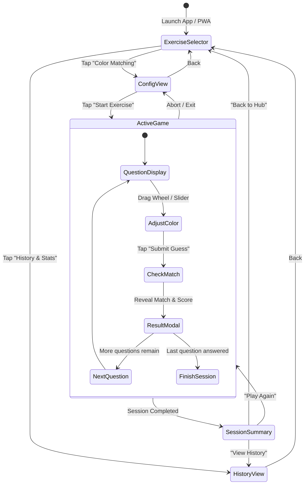

# ChromaSense (Color Mixer & Value Trainer)
## Technical Design Document & Architecture Specification

> **Version:** 1.0.0  
> **Target Platform:** iPhone (iOS Safari / PWA Standalone) & Modern Desktop/Mobile Browsers  
> **Status:** Draft / Approved for Implementation  
> **Author:** Antigravity Engineering

---

## 1. Executive Summary & Core Objectives

### 1.1 Purpose
**ChromaSense** is an offline-capable Progressive Web Application (PWA) designed primarily for artists, designers, and students to train their color perception and value observation skills.

The human visual system often conflates **Hue** (color family), **Saturation** (chromatic intensity), and **Value** (lightness / luminance). This application presents randomized color targets and tasks the user with recreating them using a dedicated **HSV Color Wheel and Vertical Value Slider**.

### 1.2 Primary Goals
1. **Accurate Color & Value Observation Training:** Provide immediate quantitative and qualitative feedback on Hue, Saturation, and Value independently, with special emphasis on Value (luminance) accuracy.
2. **True Offline Mobile Experience:** Function reliably on iPhone without an internet connection, installed to the iOS Home Screen as a standalone PWA with zero browser address bar interference.
3. **Persistent History Tracking:** Automatically save correct guesses and session statistics locally on device (`localStorage` with defensive fallbacks).
4. **Modular Extensibility:** Built around an **Exercise Registry** architecture so future agents or developers can drop in new exercise types (e.g., Grayscale Value Isolation, Palette Replication, Complementary Matching) without modifying core app plumbing.
5. **Comprehensive Unit Testing:** Color math, geometric coordinate projections, scoring algorithms, and persistence modules must be 100% unit-tested.

### 1.3 Why PWA? (Architectural Justification for iOS & Offline Execution)
A critical architectural decision of this project is delivering the application as an offline-first **Progressive Web App (PWA)** rather than requiring the user to copy raw `.html` files into the iPhone Files app and open them via `file:///` URLs.

Future agents and contributors must understand the technical constraints of iOS Safari that mandate this decision:

#### 1.3.1 Severe iOS Safari Sandboxing on Raw Files (`file:///`)
* **Broken / Insecure Storage:** In iOS Safari / WebKit, documents loaded via `file:///` are assigned an opaque/null origin. As a result, `localStorage` and `IndexedDB` either throw security exceptions (`DOMException: The operation is insecure`) or are completely purged when the preview window closes. Because one of the user's primary goals is **saving a persistent history of correct guesses**, raw files are fundamentally unsuitable.
* **No "Add to Home Screen":** iOS Safari disables the "Add to Home Screen" option for `file:///` schemes. The user cannot install it as a standalone app with a custom home screen icon.
* **Intrusive Browser Chrome:** Opening an HTML file directly leaves the Safari address bar, bottom toolbar, and tabs visible. On a compact iPhone screen, this steals critical vertical space needed for the target color swatches, color wheel, and slider.
* **CORS & Module Restrictions:** WebKit enforces strict local file policies that prevent loading external modules (`<script type="module">`), SVG assets, or worker scripts from relative paths without running into CORS errors.

#### 1.3.2 Why PWA Perfectly Solves the User's Requirements
* **Permanent, Reliable Local Persistence:** A PWA running under its own origin (whether accessed once via free static hosting like GitHub Pages/Vercel or over local Wi-Fi `http://192.168.x.x:5173`) gains a permanent, secure origin in iOS Safari. `localStorage` persists indefinitely across device reboots and app launches.
* **Native App Experience (`display: standalone`):** Once added to the iPhone Home Screen, the app launches full-screen with no browser navigation bars, utilizing the full `100dvh` viewport and honoring Apple safe-area insets.
* **100% Offline via Cache-First Service Worker (`sw.js`):** After the initial visit, the Service Worker caches all assets (HTML, CSS, JS, icons). The user can turn on **Airplane Mode** or have no cellular/Wi-Fi connection, and the app continues to launch and function flawlessly.
* **Frictionless Distribution:** The user does not need to repeatedly transfer files via AirDrop or iCloud Drive whenever updates or new exercises are added; updating is as simple as a Git push or dev server reload.

---

## 2. Technology Stack & Directory Architecture

### 2.1 Stack Decisions
* **Build Tool & Dev Server:** [Vite](https://vitejs.dev/) (fast, native ES Modules, local network `--host` support for instant testing on iPhone over Wi-Fi).
* **Core Language:** Modern Vanilla JavaScript (ES2022+ modules). No heavy UI frameworks to guarantee lightweight loading and 60+ FPS touch interactions on mobile.
* **Styling:** Vanilla CSS with custom properties (CSS design tokens), hardware-accelerated animations, and iOS safe-area handling (`env(safe-area-inset-top)` / `env(safe-area-inset-bottom)`).
* **Canvas Rendering:** High-DPI HTML5 2D `<canvas>` with offscreen caching for the circular color wheel.
* **Testing Framework:** [Vitest](https://vitest.dev/) for unit testing color algorithms, geometry, scoring, and storage.
* **PWA & Offline:** Standard Web App Manifest (`manifest.webmanifest`) and Cache-first Service Worker (`sw.js`).

### 2.2 Directory Structure
```text
Color-Mixer-Practice/
├── index.html                  # HTML entry point with iOS meta tags and mount points
├── manifest.webmanifest        # PWA configuration (standalone, icons, theme)
├── sw.js                       # Service worker for 100% offline asset caching
├── package.json                # Dependencies, scripts (dev, build, test)
├── vite.config.js              # Vite configuration (LAN host, test configuration)
├── DESIGN.md                   # This specification document
├── public/
│   ├── favicon.svg             # Vector app icon
│   ├── icon-192.png            # PWA icon 192x192
│   └── icon-512.png            # PWA icon 512x512
├── src/
│   ├── main.js                 # App entry point, router, and view coordinator
│   ├── style.css               # Global theme tokens, typography, mobile layout
│   ├── utils/
│   │   ├── color.js            # HSV/RGB/Hex/Lab math & luminance algorithms
│   │   ├── geometry.js         # Polar <-> Cartesian coordinate mappings
│   │   ├── scoring.js          # Multi-metric accuracy & Delta-E scoring engine
│   │   └── storage.js          # Defensive local persistence & data export
│   ├── components/
│   │   ├── color-wheel.js      # Circular wheel + vertical value slider control
│   │   └── swatch-viewer.js    # Target vs Guess comparison (Split & Side-by-side)
│   ├── exercises/
│   │   ├── exercise-registry.js# Modular exercise loader & catalog
│   │   └── color-matching.js   # Exercise 1: HSV Color Matching implementation
│   └── views/
│       ├── selector-view.js    # Screen 1: Exercise Hub & History entry
│       ├── config-view.js      # Screen 2: Round configuration & live UI preview
│       ├── game-view.js        # Screen 3: Active gameplay & question controller
│       ├── result-modal.js     # Screen 3.5: Per-question accuracy reveal
│       ├── summary-view.js     # Screen 4: Session recap & score logging
│       └── history-view.js     # Screen 5: Saved correct guesses & stats review
└── tests/
    ├── color.test.js           # Unit tests for color conversions and luminance
    ├── geometry.test.js        # Unit tests for color wheel touch coordinate mapping
    ├── scoring.test.js         # Unit tests for accuracy formulas & tolerances
    ├── storage.test.js         # Unit tests for localStorage operations & migration
    └── exercises.test.js       # Unit tests for question generation & registry
```

---

## 3. Mathematical Specifications & Color Models

### 3.1 HSV Color Model Definition
Colors are parameterized as $\text{HSV}(H, S, V)$:
* **Hue ($H$):** $0^\circ \le H < 360^\circ$ (Angular position on color wheel).
* **Saturation ($S$):** $0.0 \le S \le 1.0$ (Radial distance from center: $0$ = neutral white/gray, $1$ = pure chromatic pigment).
* **Value ($V$):** $0.0 \le V \le 1.0$ (Brightness/Luminance: $0$ = black, $1$ = maximum brightness).

### 3.2 Wheel Geometry & Coordinate Mapping (Reference Image Matching)
To match the user's reference image orientation:
* **Center $(x_c, y_c)$:** $S = 0.0$ (White at $V=1.0$).
* **Outer Edge $(R)$:** $S = 1.0$.
* **Hue Angle Orientation:**
  * Straight Down (6 o'clock): Pure **Red** ($H = 0^\circ$).
  * Bottom-Left (8 o'clock): **Yellow** ($H = 60^\circ$).
  * Left / Bottom-Left (10 o'clock): **Green** ($H = 120^\circ$).
  * Straight Up (12 o'clock): **Cyan** ($H = 180^\circ$).
  * Top-Right (2 o'clock): **Blue** ($H = 240^\circ$).
  * Bottom-Right (4 o'clock): **Magenta** ($H = 300^\circ$).

#### Geometric Conversion Formulas:
Let screen coordinate origin $(0, 0)$ be top-left of the canvas. Center is $(x_c, y_c)$ and usable radius is $R$.
1. **Screen Point $(x, y) \to (H, S)$:**
   $$\Delta x = x - x_c, \quad \Delta y = y - y_c$$
   $$\text{distance } d = \sqrt{\Delta x^2 + \Delta y^2}$$
   $$S = \min\left(1.0, \frac{d}{R}\right)$$
   $$\theta_{\text{raw}} = \text{atan2}(\Delta y, \Delta x) \times \frac{180}{\pi} \quad (\theta_{\text{raw}} \in [-180^\circ, 180^\circ])$$
   $$\theta_{\text{screen}} = (\theta_{\text{raw}} + 360) \pmod{360}$$
   $$H = (\theta_{\text{screen}} - 90 + 360) \pmod{360}$$
   *Center Deadzone Handling:* If distance $d < 2\text{px}$ (dead center where radial distance approaches 0 and hue angle is geometrically undefined), preserve the previous valid hue value rather than jumping abruptly to $270^\circ$.

2. **Inverse $(H, S) \to \text{Screen Point } (x, y)$:**
   $$\theta_{\text{screen}} = (H + 90) \pmod{360}$$
   $$\theta_{\text{rad}} = \theta_{\text{screen}} \times \frac{\pi}{180}$$
   $$x = x_c + (S \times R) \times \cos(\theta_{\text{rad}})$$
   $$y = y_c + (S \times R) \times \sin(\theta_{\text{rad}})$$

### 3.3 Vertical Value Slider Geometry
* The Value bar is a vertical rounded slider placed adjacent to the wheel.
* Top of slider ($y = 0$): $V = 1.0$ (White / Full Value).
* Bottom of slider ($y = h_{\text{track}}$): $V = 0.0$ (Black / Zero Value).
* Mapping:
  $$V = 1.0 - \min\left(1.0, \max\left(0.0, \frac{y - y_{\text{top}}}{h_{\text{track}}}\right)\right)$$
  $$y_{\text{thumb}} = y_{\text{top}} + (1.0 - V) \times h_{\text{track}}$$

### 3.4 Color Conversions & Luminance
1. **HSV to RGB:**
   $$C = V \times S, \quad X = C \times \left(1 - \left|\left(\frac{H}{60}\right) \bmod 2 - 1\right|\right), \quad m = V - C$$
   $$(R', G', B') = \text{standard 6-sector piecewise function based on } \lfloor H / 60 \rfloor$$
   $$R = \text{round}((R' + m) \times 255), \quad G = \text{round}((G' + m) \times 255), \quad B = \text{round}((B' + m) \times 255)$$

2. **Relative Luminance (Value Observation Standard):**
   $$Y = 0.2126 \times R_{\text{lin}} + 0.7152 \times G_{\text{lin}} + 0.0722 \times B_{\text{lin}}$$
   where $C_{\text{lin}} = C \le 0.04045 ? \frac{C}{12.92} : \left(\frac{C + 0.055}{1.055}\right)^{2.4}$.

### 3.5 Two-Tier High-DPI Canvas Rendering Engine (Retina 60–120 FPS Optimization)
Modern iPhones operate at a 3x Retina display density (`window.devicePixelRatio = 3.0`). Recomputing hundreds of thousands of polar HSV pixels inside a `pointermove` event would cause dropped frames, laggy touch responsiveness, and battery drain.

To guarantee a fluid 60–120 FPS touch interaction:
1. **Tier 1 (Offscreen Pre-Render Layer):**
   * Upon component mount or window resize, the polar color wheel gradient is baked once into a detached, offscreen `<canvas>` at full native resolution (`width * dpr`, `height * dpr`).
   * **ResizeObserver & Integer Device Pixel Rounding:** Canvas sizing is tracked via `ResizeObserver` using integer device pixel scaling (`Math.round(rect.width * Math.min(window.devicePixelRatio || 1, 3))`). Re-baking is only triggered when physical pixel dimensions change, preventing redundant baking during subpixel layout shifts.
   * The pixel buffer is cached in memory.
2. **Tier 2 (Interactive Compositor Layer):**
   * During active dragging (`pointermove`), the foreground canvas executes a single `ctx.drawImage(offscreenCanvas, 0, 0)` call, followed immediately by drawing the reticle indicator circle.
   * Frame execution cost drops from $\sim 16\text{ms}$ to $< 0.4\text{ms}$, delivering instantaneous responsiveness to the user's thumb.

---

## 4. Accuracy & Scoring Engine

### 4.1 Channel Metrics
When the user submits a guess $(H_g, S_g, V_g)$ against target $(H_t, S_t, V_t)$:

1. **Value Match ($\text{Acc}_V$):**
   $$\Delta V = |V_t - V_g|$$
   $$\text{Acc}_V = \max(0, (1.0 - \Delta V) \times 100)\%$$
   *(Provides dedicated feedback for artists focusing on value perception).*

2. **Saturation Match ($\text{Acc}_S$):**
   $$\Delta S = |S_t - S_g|$$
   $$\text{Acc}_S = \max(0, (1.0 - \Delta S) \times 100)\%$$

3. **Hue Match ($\text{Acc}_H$):**
   $$\text{Angular Diff } \Delta \theta = \min(|H_t - H_g|, 360 - |H_t - H_g|)$$
   *Perceptual adjustment:* When saturation is near 0 or value is near 0, hue differences are perceptually invisible. The effective hue penalty is scaled by $\max(S_t, 0.15) \times \max(V_t, 0.15)$:
   $$\text{Effective } \Delta H = \Delta \theta \times \sqrt{S_t \times V_t}$$
   $$\text{Acc}_H = \max\left(0, \left(1.0 - \frac{\text{Effective } \Delta H}{180}\right) \times 100\right)\%$$

4. **Overall Score:**
   $$\text{Overall Accuracy} = 0.40 \times \text{Acc}_V + 0.35 \times \text{Acc}_H + 0.25 \times \text{Acc}_S$$
   *(Note on CIE Delta-E: Perceptual Lab Delta-E distance is reserved as an optional advanced mode. Core scoring for Phase 1 relies strictly on the weighted HSV channel formula above).*

5. **Target Generation Training Bounds:**
   * To prevent degenerate and visually ambiguous training targets (e.g. pure black or desaturated gray where hue differences are completely imperceptible to the human eye), the Color Matching exercise generates targets within realistic chromatic bounds:
     $$H_t \in [0, 360), \quad S_t \in [0.15, 1.0], \quad V_t \in [0.15, 1.0]$$
   * (Dedicated grayscale and pure luminance observation drills are isolated to Exercise 2: Value Isolation).

### 4.2 "Correct Guess" Classification & Tunable Threshold
Each submitted color match is evaluated against a **Tunable Correctness Threshold** to determine whether it is counted as a **Correct Guess** or a **Wrong Guess**.

#### 4.2.1 Tunable Threshold Architecture
Because perceptual difficulty varies by display calibration and user skill level, the threshold is **strictly decoupled from UI logic** and stored as a centralized configuration parameter:
* **Default Threshold (`CORRECTNESS_THRESHOLD`):** $\ge 85.0\%$ overall accuracy (with room to tune in `src/utils/scoring.js` or via settings).
* **Evaluation Rule:**
  $$\text{isCorrect} = (\text{Overall Accuracy} \ge \text{CORRECTNESS\_THRESHOLD})$$
* **Result Logging:** Every question submission permanently records:
  * `isCorrect: true` $\implies$ Increments `totalCorrect`
  * `isCorrect: false` $\implies$ Increments `totalWrong`
  * Timestamp, target color, user guess, and full channel breakdowns ($\Delta V, \Delta H, \Delta S$).

#### 4.2.2 Accuracy Tiers
* **$96\%\text{--}100\%$:** 🌟 Master Eye (Flawless)
* **$90\%\text{--}95\%$:** 🎯 Excellent Match (Correct)
* **$85\%\text{--}89\%$:** 👍 Solid Match (Correct - within tolerance)
* **$< 85\%$:** ❌ Needs Adjustment (Wrong - color disparity exceeds threshold)

---

## 5. User Flows & Screen Specifications



### 5.1 Screen 1: Exercise Hub (`selector-view.js`)
* **Header:** App title "ChromaSense", subtle branding, and a dedicated **History & Stats** button with quick badge count of total correct guesses.
* **Exercise Grid:**
  * **Card 1 (Active):** **Exercise 1: Color Matching (HSV)**
    * Description: *Observe random target colors and adjust Hue, Saturation, and Value to match.*
    * Badge: *Ready to Play*
    * Tapping navigates to Configuration Landing Page.
  * **Card 2 (Extensible Slot):** **Exercise 2: Value & Luminance Isolation**
    * Description: *Pure grayscale & luminance perception drill.*
    * Badge: *Coming Soon* (Disabled / Lock Icon)
  * **Card 3 (Extensible Slot):** **Exercise 3: Complementary & Harmonic Mixing**
    * Description: *Find the exact complement and perceptual triadic colors.*
    * Badge: *Coming Soon* (Disabled)

### 5.2 Screen 2: Configuration Landing (`config-view.js`)
* **Breadcrumb / Back Button:** Returns to Exercise Hub.
* **Per-Mode Performance & Accuracy Breakdown List:**
  * Because different modes (e.g., HSV vs future RGB or Grayscale) test fundamentally different mental models, performance is **tracked and displayed separately per mode** directly on this configuration page:
  * **Mode Stats Card List:**
    * **Mode: HSV (Wheel + Value):**
      * Mode badge: `Active Mode`
      * **All-Time:** `XX.X% Accuracy` $\cdot$ `X Correct / Y Wrong` (e.g. `91.4% · 48 Correct / 12 Wrong`)
      * **Past 7 Days:** `XX.X% Accuracy` $\cdot$ `X Correct / Y Wrong` (e.g. `94.0% · 15 Correct / 1 Wrong`)
      * Trend badge (e.g., `+2.6% vs All-Time`) or *Empty State* ("No sessions in past 7 days").
    * **Future Modes (RGB Sliders, Grayscale Value Only):**
      * Listed as reserved slots showing `No data yet (Mode locked)` or independent stats once enabled.
  * *Selecting or toggling between modes highlights that mode's detailed record and updates the preview immediately.*
* **Question Count Selector:**
  * Interactive selection chips: `[ 1 ]` `[ 5 ]` `[ 10 ]` `[ 15 ]` `[ 20 ]` (Default: `5`).
* **Color Mode Selector:**
  * Active pill: `[ HSV (Wheel + Value) ]`.
  * Future disabled pills: `[ RGB Sliders ]` `[ Grayscale Value Only ]`.
* **Live Interactive Preview Section:**
  * Directly displays the Canvas Color Wheel and Vertical Slider control for the selected mode.
  * Tapping/dragging adjusts a live preview swatch on the landing page, allowing the user to familiarize themselves with the touch sensitivity before starting a scored session.
* **Action CTA:** Prominent **"Start Exercise"** button.

### 5.3 Screen 3: Active Exercise (`game-view.js`)
* **Mobile-First Layout Optimized for iPhone:**
  * Top navigation bar with question index indicator (`Question 2 / 5`), current round score, and a quick "Quit" button with confirmation.
* **Top Half: Swatch Comparison Area:**
  * Dual-swatch display: **Target Color** vs **Your Guess Color**.
  * **Split-View / Contact Seam:** Swatches meet along a sharp center boundary (essential for artists to detect value and hue micro-contrast).
  * **View Mode Toggle:** Switch between *Split Contact View* and *Side-by-Side View*.
  * **Value Check (Tonal Aid) Toggle:** An optional button that temporarily desaturates both swatches to grayscale using accurate luminance weights, allowing the user to inspect whether their lightness/value matches before guessing hue.
* **Bottom Half: Color Adjustment UI:**
  * High-DPI Canvas Color Wheel with touch-point reticle.
  * Vertical Value Slider with circular thumb.
  * Touch optimization: `touch-action: none` to completely eliminate iPhone bounce-scroll and swipe-navigation conflicts.
  * Fine-tuning stepper buttons (subtle `+` / `-` for $1^\circ$ Hue, $1\%$ Saturation, $1\%$ Value) for fingertip precision on compact phone screens.
* **Submission:** Primary "Submit Guess" button.

### 5.4 Screen 3.5: Result Feedback Modal / Sheet (`result-modal.js`)
* Pops up smoothly over the screen immediately after submitting.
* Displays side-by-side color reveal with target vs guess hex codes.
* Displays **Overall Accuracy %** in large vibrant typography.
* Three progress bar gauges:
  * **Value Accuracy %** (highlighted)
  * **Hue Accuracy %**
  * **Saturation Accuracy %**
* Outcome Badge: "🌟 Master Eye!" or "👍 Correct Guess Saved!" or "Keep Trying".
* CTA: **"Next Question →"** or **"View Summary"** if final question.

### 5.5 Screen 4: Session Summary (`summary-view.js`)
* Comprehensive review card showing:
  * Final Session Score & Average Accuracy %.
  * Correct Guesses count (e.g., `4 / 5 Correct`).
  * Best Match of the round.
* Scrollable review list: Cards for each question displaying Target swatch vs Guess swatch, Delta percentages, and individual question status.
* Auto-saves session and correct guesses to local database.
* Actions: "Play Again", "Configure Another Round", "View Full History".

### 5.6 Screen 5: History & Statistics Hub (`history-view.js`)
* **Lifetime Stats Cards:**
  * Total Sessions Completed
  * Total Correct Guesses
  * Lifetime Average Accuracy
  * Lifetime Average Value Match %
* **Correct Guesses Gallery:**
  * Filterable gallery of colors successfully identified.
  * Shows target color swatch, user guess swatch, timestamp, and match percentages.
* **Data Management:**
  * **Export to JSON:** Copies or downloads a complete JSON backup of the user's progress.
  * **Import JSON:** Restore progress across devices.
  * **Clear History:** Protected with a modal confirmation.

---

## 6. Modular Exercise Architecture (Future-Proofing)

To make it effortless for future AI agents or developers to add new exercises without touching core navigation or storage plumbing:

### 6.1 The `Exercise` Interface
Every exercise implements a standard lifecycle:
```javascript
export class BaseExercise {
  // Metadata
  id = 'unique-exercise-id';
  name = 'Exercise Display Name';
  description = 'Brief exercise summary';
  version = '1.0.0';

  // Config schema
  getConfigSchema() {
    return {
      questionCounts: [1, 5, 10, 15, 20],
      defaultCount: 5,
      modes: ['HSV'],
      defaultMode: 'HSV'
    };
  }

  // Question Generator
  generateQuestion(config) {
    // Returns: { id, targetColor: { h, s, v, rgb, hex }, metadata }
  }

  // Evaluation
  evaluate(target, userGuess) {
    // Returns: { score, isCorrect, breakdown: { value, hue, saturation }, details }
  }

  // UI Component rendering
  renderPlayControls(container, { currentGuess, onChange }) {
    // Mounts exercise-specific UI (e.g. Wheel, RGB sliders, Value bar)
  }
}
```

### 6.2 The `ExerciseRegistry`
`src/exercises/exercise-registry.js` maintains the active catalog:
```javascript
import { ColorMatchingExercise } from './color-matching.js';

export const exerciseRegistry = [
  new ColorMatchingExercise(),
  // Future agents simply add:
  // new ValueIsolationExercise(),
  // new ComplementaryExercise(),
];
```

---

## 7. State Management & Storage Schema

### 7.1 Defensive Storage Service (`src/utils/storage.js`)
iOS Safari in private browsing or under low-storage conditions can throw `QuotaExceededError` or `SecurityError`. The storage service implements:
1. In-memory fallback if `localStorage` throws or is blocked.
2. Versioned schema with automatic migration.
3. Export / Import serialization.

### 7.2 Stored Schema Definition (`chromasense_data_v1`)
```json
{
  "version": 1,
  "stats": {
    "totalSessions": 12,
    "totalQuestions": 60,
    "totalCorrect": 48,
    "totalWrong": 12,
    "averageAccuracy": 91.4,
    "averageValueAccuracy": 93.8,
    "modeStats": {
      "HSV": {
        "totalQuestions": 60,
        "totalCorrect": 48,
        "totalWrong": 12,
        "averageAccuracy": 91.4
      }
    }
  },
  "settings": {
    "defaultQuestionCount": 5,
    "defaultViewMode": "split",
    "accuracyThreshold": 85.0,
    "hapticFeedback": true
  },
  "history": [
    {
      "id": "hist_1728720000000_1",
      "timestamp": "2026-10-12T15:20:00Z",
      "exerciseId": "color-matching",
      "mode": "HSV",
      "target": { "h": 210, "s": 0.65, "v": 0.82, "hex": "#498cd1" },
      "guess":  { "h": 214, "s": 0.63, "v": 0.80, "hex": "#4c87cc" },
      "score": 94.2,
      "breakdown": {
        "value": 98.0,
        "hue": 92.5,
        "saturation": 96.0
      },
      "isCorrect": true
    }
  ]
}
```

### 7.3 Analytics & Time-Window Query Engine (`src/utils/storage.js`)
To power the Configuration Landing screen's per-mode stats list and the History review, `StorageService` exposes fast aggregation functions with mode-level filtering:

> [!IMPORTANT]
> **Lifetime Counters vs. Windowed History:**  
> Because the `history` array is capped at 1,000 items via FIFO eviction (Section 7.4), querying **All-Time** statistics (`windowDays = null`) must read directly from the permanent, monotonic counters stored in `stats.modeStats[mode]` (or global `stats`). The `history` array filter is reserved for rolling time windows (e.g. past 7 days) and the History Gallery.

```javascript
/**
 * Computes accuracy metrics across a specific rolling time window and mode.
 * @param {number|null} windowDays - Number of days to look back (e.g. 7 for past week, null for all-time).
 * @param {string|null} mode - Specific color mode to filter by (e.g. 'HSV', or null for all).
 * @returns {{ totalGuesses: number, correct: number, wrong: number, accuracyPercent: number, averageScore: number }}
 */
export function getAccuracyStats(windowDays = null, mode = null) {
  const store = getStore();

  // All-Time query: read directly from permanent lifetime counters
  if (!windowDays && mode && store.stats.modeStats?.[mode]) {
    const ms = store.stats.modeStats[mode];
    return {
      totalGuesses: ms.totalQuestions || 0,
      correct: ms.totalCorrect || 0,
      wrong: ms.totalWrong || 0,
      accuracyPercent: ms.averageAccuracy || 0,
      averageScore: ms.averageAccuracy || 0
    };
  }

  // Rolling time-window query: compute from bounded history array
  const history = store.history || [];
  const now = Date.now();
  const cutoff = windowDays ? now - (windowDays * 24 * 60 * 60 * 1000) : 0;

  const filtered = history.filter(item => {
    const matchesTime = !windowDays || new Date(item.timestamp).getTime() >= cutoff;
    const matchesMode = !mode || item.mode === mode;
    return matchesTime && matchesMode;
  });

  if (filtered.length === 0) {
    return { totalGuesses: 0, correct: 0, wrong: 0, accuracyPercent: 0, averageScore: 0 };
  }

  const correct = filtered.filter(item => item.isCorrect).length;
  const wrong = filtered.length - correct;
  const accuracyPercent = Math.round((correct / filtered.length) * 1000) / 10;
  const averageScore = Math.round((filtered.reduce((sum, item) => sum + item.score, 0) / filtered.length) * 10) / 10;

  return {
    totalGuesses: filtered.length,
    correct,
    wrong,
    accuracyPercent,
    averageScore
  };
}

/**
 * Generates an aggregated breakdown of all active modes for the Configuration Landing screen.
 * @param {string[]} modes - List of modes to query, e.g. ['HSV']
 * @returns {Record<string, { allTime: object, past7Days: object }>}
 */
export function getModeStatsSummary(modes = ['HSV']) {
  const summary = {};
  for (const m of modes) {
    summary[m] = {
      allTime: getAccuracyStats(null, m),
      past7Days: getAccuracyStats(7, m)
    };
  }
  return summary;
}
```

### 7.4 Storage Bounding & Quota Protection
`localStorage` on iOS Safari provides approximately 5MB of storage per origin. While individual guess objects are compact (~200 bytes), thousands of attempts over months must not trigger browser quota exceptions.

To ensure long-term stability:
1. **Bounded History Array (`MAX_HISTORY_ITEMS = 1000`):**
   * The detailed `history` array stores the most recent **1,000 individual guesses** using a FIFO (first-in, first-out) eviction policy.
   * This provides ample depth for rolling 7-day analytics and past session reviews without bloating local storage.
2. **Permanent Lifetime Counters:**
   * Aggregate statistics in `stats` and `stats.modeStats` (such as `totalQuestions`, `totalCorrect`, `totalWrong`, `allTimeAccuracy`) are **never pruned**. They increment monotonically and retain the user's lifetime record forever.
3. **Export / Import Backup Guarantee:**
   * Users can click "Export Backup (JSON)" at any time to download or copy their raw training history.
   * "Import Backup (JSON)" merges or restores records safely with schema validation.

---

## 8. iOS Safari PWA Implementation & Mobile Ergonomics

### 8.1 PWA Manifest (`manifest.webmanifest`)
* `"display": "standalone"` (hides Safari browser navigation and URL bar).
* `"orientation": "portrait"` (optimized for handheld phone usage).
* `"background_color": "#0d0e12"` (matches app theme to prevent white flash during startup).
* `"theme_color": "#0d0e12"`.

### 8.2 Apple-Specific Meta Tags (`index.html`)
```html
<meta name="apple-mobile-web-app-capable" content="yes" />
<meta name="apple-mobile-web-app-status-bar-style" content="black-translucent" />
<meta name="apple-mobile-web-app-title" content="ChromaSense" />
<meta name="viewport" content="width=device-width, initial-scale=1.0, maximum-scale=1.0, user-scalable=no, viewport-fit=cover" />
```

### 8.3 Mobile Touch Ergonomics & Pointer Capture Architecture
* **Gesture Hijack Isolation:**
  * CSS `touch-action: none` applied to the color wheel canvas, container, and vertical slider track to completely disable default Safari pull-to-refresh, page navigation swipe, and inertial scroll bounce.
* **Continuous Tracking via `PointerEvent` APIs:**
  * On `pointerdown`: Invokes `e.target.setPointerCapture(e.pointerId)`.
  * On `pointermove`: Processes touch coordinates seamlessly even if the user's thumb moves outside the boundary of the canvas or slider track.
  * On `pointerup` / `pointercancel`: Invokes `e.target.releasePointerCapture(e.pointerId)`.
  * **Boundary Clamping:** If the pointer distance $d > R$, saturation is gracefully clamped to $1.0$ while preserving the continuous angle $\theta$. The reticle ring visually tracks the circumference rather than breaking or freezing.
* **Dynamic Viewport & Safe Areas:**
  * Uses `height: 100dvh` to seamlessly adapt to the iOS dynamic island, home indicator bar, and floating status bar.
  * Safe area CSS padding:
    ```css
    padding-top: max(16px, env(safe-area-inset-top));
    padding-bottom: max(16px, env(safe-area-inset-bottom));
    padding-left: max(16px, env(safe-area-inset-left));
    padding-right: max(16px, env(safe-area-inset-right));
    ```

### 8.4 Service Worker Cache Lifecycle & Zero-Friction Updates (`sw.js`)
To prevent the common "Stale PWA" problem on iOS (where an installed app continues running old code indefinitely after an update):
* **Versioned Cache Namespace:**
  * Uses a semver cache key: `const CACHE_NAME = 'chromasense-v1.0.0'`.
* **Instant Activation & Auto-Eviction:**
  * `install` event calls `self.skipWaiting()` immediately upon caching static assets.
  * `activate` event deletes all legacy caches that do not match `CACHE_NAME`, followed by `self.clients.claim()` so the active client is controlled without waiting for a manual app relaunch.
* **Update Listener:**
  * `src/main.js` listens to `serviceWorker.oncontrollerchange` to reload or prompt a seamless reload when new code is detected.
* **Production Environment Gating:**
  * To prevent the Service Worker from aggressively intercepting Vite's Hot Module Replacement (HMR) and dynamic module bundling during local development (`npm run dev`), SW registration is conditionally enabled only in production builds:
    ```javascript
    if ('serviceWorker' in navigator && import.meta.env.PROD) {
      window.addEventListener('load', () => {
        navigator.serviceWorker.register('/sw.js');
      });
    }
    ```

### 8.5 iOS-Compatible Micro-Interactions & Visual Haptics
* **WebKit Haptic Limitation:** Apple WebKit on iOS blocks the standard `navigator.vibrate()` API for security and privacy.
* **Visual Tactile Solution:**
  * The app provides rich tactile feedback via hardware-accelerated CSS micro-animations:
    * **Reticle Press Micro-Scale:** When touching the color wheel, the reticle ring subtly expands (`transform: scale(1.18)`) with a high-contrast white/black outline, shrinking back with a snappy cubic-bezier spring upon release.
    * **Target Match Flash:** When an attempt scores $\ge 85\%$ (correct match), the comparison swatch triggers an energetic emerald shimmer glow animation.
    * **Audio Click Option:** Provides an optional toggle for synthetic micro-clicks using the Web Audio API (a short 20ms sine impulse at 880Hz) to simulate mechanical dial detents without vibrating the device.

---

## 9. Comprehensive Unit Test Plan

The project uses [Vitest](https://vitest.dev/) to achieve extensive coverage across all non-UI logic.

> [!NOTE]
> **Test Environment & Storage Adapter:**  
> Vitest executes in Node.js by default. To test `storage.js` and pointer/touch geometry behaviors headlessly without missing browser globals (`window`, `localStorage`, `PointerEvent`), either configure `happy-dom` (`npm i -D happy-dom`, `test: { environment: 'happy-dom' }` in `vite.config.js`) or implement a mockable backend storage provider in `src/utils/storage.js`.

| Test Suite | File | Test Cases |
| :--- | :--- | :--- |
| **Color Math** | `tests/color.test.js` | HSV $\to$ RGB conversion accuracy (extremes: pure red, black, white, gray, boundary hues 0°, 60°, 120°, 180°, 240°, 300°, 360°). RGB $\to$ HSV round-trip integrity. Relative luminance calculation for known standard colors. Hex formatting and parsing. |
| **Geometry** | `tests/geometry.test.js` | Angle-to-Hue mapping (ensuring 6 o'clock is 0° Red, 12 o'clock is 180° Cyan, etc.). Radial distance-to-Saturation mapping. Inverse (H, S) $\to$ (X, Y) projection. Center deadzone hue preservation ($d < 2\text{px}$). Out-of-bounds pointer clamping (drag outside canvas radius clamps gracefully to $S=1.0$). Value slider $(y \to V)$ clamping between $0.0$ and $1.0$. |
| **Scoring** | `tests/scoring.test.js` | Identical match yields 100% score. Pure value mismatch calculation. Pure hue mismatch calculation. Desaturated color edge cases (where hue delta is down-weighted). **Tunable threshold tests:** verifying `isCorrect: true` when score $\ge \text{threshold}$ and `isCorrect: false` when below threshold; custom threshold overrides. Target generation bounds ($S \ge 0.15, V \ge 0.15$). |
| **Storage** | `tests/storage.test.js` | Successful save and load from storage. Schema version validation and fallback handling. Corrupted JSON recovery. In-memory fallback when `localStorage` throws `SecurityError`. **Analytics queries:** verify `totalCorrect` and `totalWrong` accumulation; **7-day rolling window tests** (correctly includes attempts from 1, 3, 6 days ago; excludes attempts from 8+ days ago; handles empty window gracefully). **Mode isolation tests:** verify that attempts in mode `HSV` do not corrupt or bleed into other mode buckets. **Quota protection tests:** verify 1,000 item FIFO pruning while preserving monotonically increasing lifetime counters. Export/import JSON backup integrity. |
| **Exercises** | `tests/exercises.test.js` | Question generator outputs valid $H \in [0, 360), S \in [0, 1], V \in [0, 1]$. Exercise registry returns correct list of active exercises and handles uninitialized modules gracefully. |

---

## 10. Implementation Phasing Roadmap

* **Phase 1 (Foundation):** Core color math, geometry, scoring engine, storage service, and Vitest test suites.
* **Phase 2 (Touch Components):** High-DPI Canvas Color Wheel, Vertical Value Slider, Split/Side-by-side swatch viewer.
* **Phase 3 (View System):** Exercise Hub (Screen 1), Configuration Landing with live preview (Screen 2), and History Hub (Screen 5).
* **Phase 4 (Gameplay Flow):** Active Game controller (Screen 3), Result Feedback sheet (Screen 3.5), and Session Summary (Screen 4).
* **Phase 5 (PWA & Offline Packaging):** Service Worker, Web App Manifest, iOS safe-area polish, and production build verification.
