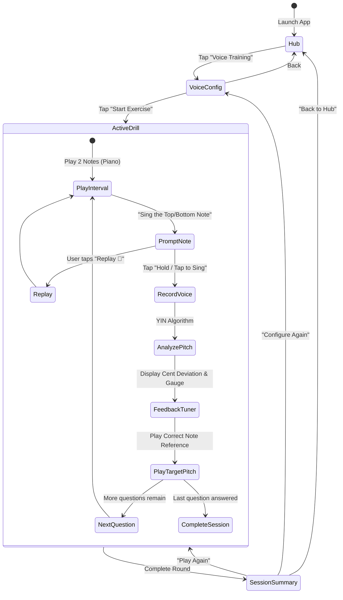

# ChromaSense / Practice App: Voice Training Architecture & Technical Specification
## Module: Vocal Pitch & Interval Breakdown (`voice-training`)

---

## 1. Executive Summary & Vision

The **Voice Training (`voice-training`)** module expands the practice application from purely visual color observation into multi-sensory ear and vocal pitch perception training.

The primary exercise introduced in this specification is **"Interval Breakdown"**:
1. The app plays a two-note harmonic or melodic interval on a synthesized acoustic piano within the user's configured vocal range (between **C3** and **C7**).
2. The user is prompted to isolate and sing either the **Bottom Note** or the **Top Note**.
3. The app records the user's voice via the microphone, detects the sung fundamental pitch ($F_0$), computes the exact deviation in **cents**, reveals visual tuner feedback, plays back the target reference pitch, and logs the result.
4. Historical accuracy (past 30 days) is tracked per individual interval (from Minor 2nd up to Octave), giving singers and ear-training students targeted insights into their specific vocal weaknesses.

---

## 2. Musical & Mathematical Foundations

### 2.1 The 12 Chromatic Intervals
The exercise covers all 12 equal-temperament intervals from 1 to 12 semitones:

| Semitones | Short Code | Interval Name | Frequency Ratio ($2^{n/12}$) | Difficulty Tier |
|:---:|:---:|:---|:---:|:---:|
| 1 | `m2` | Minor 2nd | $\approx 1.0595$ | Hard (Dissonant / Micro-step) |
| 2 | `M2` | Major 2nd | $\approx 1.1225$ | Medium |
| 3 | `m3` | Minor 3rd | $\approx 1.1892$ | Medium |
| 4 | `M3` | Major 3rd | $\approx 1.2599$ | Easy (Triad Foundation) |
| 5 | `P4` | Perfect 4th | $\approx 1.3348$ | Medium |
| 6 | `TT` | Tritone (dim 5th / aug 4th) | $\approx 1.4142$ | Hard (Dissonant) |
| 7 | `P5` | Perfect 5th | $\approx 1.4983$ | Easy (Acoustic Resonance) |
| 8 | `m6` | Minor 6th | $\approx 1.5874$ | Medium |
| 9 | `M6` | Major 6th | $\approx 1.6818$ | Medium |
| 10 | `m7` | Minor 7th | $\approx 1.7818$ | Hard |
| 11 | `M7` | Major 7th | $\approx 1.8877$ | Hard (Leading Tone) |
| 12 | `P8` | Perfect Octave | $2.0000$ | Easy (Identity Resonance) |

---

### 2.2 Pitch & Frequency Calculations
1. **MIDI Note to Frequency ($A4 = 440\text{ Hz}$, MIDI 69):**
   $$f(m) = 440 \times 2^{\frac{m - 69}{12}}$$

2. **Frequency to Fractional MIDI Note:**
   $$m(f) = 69 + 12 \log_2\left(\frac{f}{440}\right)$$

3. **Cent Deviation Calculation ($\Delta \text{cents}$):**
   Given detected vocal frequency $f_{\text{sung}}$ and target note frequency $f_{\text{target}}$:
   $$\Delta \text{cents} = 1200 \times \log_2\left(\frac{f_{\text{sung}}}{f_{\text{target}}}\right)$$

4. **Correctness & Accuracy Thresholds:**
   * **Flawless Pitch (🌟 Master Voice):** $|\Delta \text{cents}| \le 12 \text{ cents}$
   * **Accurate / Correct Guess (🎯 In Tune):** $|\Delta \text{cents}| \le 50 \text{ cents}$ (within a quarter-tone; counted as `isCorrect: true`)
   * **Off-Pitch / Wrong Guess (❌ Out of Tune):** $|\Delta \text{cents}| > 50 \text{ cents}$ (counted as `isCorrect: false`)

---

### 2.3 Note Range Bounds (C3 to C7)
- **Minimum Note:** C3 (MIDI 48, $130.81\text{ Hz}$) — Low baritone / tenor register.
- **Maximum Note:** C7 (MIDI 96, $2093.00\text{ Hz}$) — Whistle / high soprano register.
- **Configurable Range:** Dual slider selecting $[\text{Note}_{\text{from}}, \text{Note}_{\text{to}}]$ constrained to $\text{Note}_{\text{to}} - \text{Note}_{\text{from}} \ge \text{selected interval}$.
- **Persistent Memory:** Stored in `localStorage` (`voice_range_from`, `voice_range_to`) and restored automatically across sessions.

---

## 3. Audio & Synthesis Architecture

```
+-------------------------------------------------------------------+
|                        Web Audio Context                          |
|                                                                   |
| [ PianoSynth ]                                                    |
|  Harmonic Osc 1 (Fundamental) -\                                  |
|  Harmonic Osc 2 (2nd Harmonic) --> GainNode (ADSR Envelope) ----> | Destination
|  Harmonic Osc 3 (3rd Harmonic) -/                                 | (Speakers)
|  Noise Burst (Hammer transient)-/                                 |
|                                                                   |
+-------------------------------------------------------------------+
                                                                    
+-------------------------------------------------------------------+
|                       Vocal Microphone Input                      |
|                                                                   |
| navigator.mediaDevices.getUserMedia({ audio: true })              |
|        |                                                          |
|        v                                                          |
|  [ MediaStreamSource ]                                            |
|        |                                                          |
|        v                                                          |
|  [ AnalyserNode (FFT & Time Domain) ]                             |
|        |                                                          |
|        v                                                          |
|  [ YIN / Autocorrelation Pitch Detector ]                         |
|        |                                                          |
|        +--> RMS Voice Activity Detection (Filters silence)        |
|        +--> Parabolic Interpolation (Sub-bin frequency)           |
|        +--> Median Filter (Removes vibrato & attack glide)        |
|        v                                                          |
|  Target vs Detected Pitch Comparison                              |
+-------------------------------------------------------------------+
```

### 3.1 Procedural Piano Tone Synthesis (`PianoSynth`)
To maintain zero network downloads, instant responsiveness, and 100% offline PWA reliability, piano notes are procedurally synthesized using `AudioContext`:
1. **Multi-Harmonic Additive Synthesis:**
   - Harmonic 1 (Fundamental $f$): Amplitude $1.0$, decay $\tau_1 \approx 2.4\text{s}$.
   - Harmonic 2 ($2f$): Amplitude $0.4$, decay $\tau_2 \approx 1.8\text{s}$.
   - Harmonic 3 ($3f$): Amplitude $0.15$, decay $\tau_3 \approx 1.2\text{s}$.
   - Harmonic 4 ($4f$): Amplitude $0.05$, decay $\tau_4 \approx 0.8\text{s}$.
2. **Hammer Percussion Transient:**
   - A $15\text{ms}$ bandpass-filtered noise impulse simulating felt hammer contact with steel wire.
3. **Exponential Decay Envelope:**
   - Attack: $0.005\text{s}$.
   - Release: Smooth natural exponential decay to silence.

### 3.2 Pitch Detection Algorithm (YIN / Normalized Autocorrelation)
Human singing voice contains formant resonances and strong harmonics that cause naive FFT peak detectors to produce octave errors. We implement the **YIN Pitch Detection algorithm**:
1. **Difference Function:**
   $$d_t(\tau) = \sum_{j=1}^{W} (x_j - x_{j+\tau})^2$$
2. **Cumulative Mean Normalized Difference:**
   $$d'_t(\tau) = \begin{cases} 1 & \text{if } \tau = 0 \\ \frac{d_t(\tau)}{\frac{1}{\tau}\sum_{j=1}^{\tau} d_t(j)} & \text{otherwise} \end{cases}$$
3. **Absolute Thresholding:**
   Identify the first dip of $d'_t(\tau) < 0.12$.
4. **Parabolic Interpolation:**
   Refine the discrete minimum $\tau^*$ using quadratic peak fitting to achieve sub-Hertz accuracy.
5. **Silence & Voicing Gate:**
   Ignore frames where $\text{RMS} < 0.015$ to avoid analyzing ambient room noise.

---

## 4. Screen Specifications & User Flows



### 4.1 Screen 1: Exercise Hub (`selector-view.js`)
- Activate Slot 2: **"Voice Training: Interval Breakdown"** card.
- Displays dynamic status badge: *Ready to Play*, icon: 🎙️, description: *Isolate and sing individual notes within two-note piano intervals.*

### 4.2 Screen 2: Voice Configuration (`voice-config-view.js`)
- **Mode Selector:**
  - Active: `[ Interval Breakdown ]`.
- **Note Range Dual-Slider (C3 to C7):**
  - Interactive dual-thumb range slider from C3 (MIDI 48) to C7 (MIDI 96).
  - Preset quick chips: `[ Tenor / Bass (C3-E4) ]` `[ Alto / Soprano (A3-C5) ]` `[ Full Range (C3-C7) ]`.
  - Stored in `localStorage` and remembered on subsequent visits.
- **12 Interval Toggle Chips (with 30-Day Accuracy Stats):**
  - Each chip shows interval name (`m2`, `M2`, `m3`, ..., `P8`).
  - Below each chip, displays rolling 30-day accuracy badge (e.g. `92% Acc · 12 Solved` or `No data`).
  - Allows selecting any combination (at least 1 must remain enabled).
- **Question Count Chips:**
  - `[ 1 ]` `[ 5 ]` `[ 10 ]` `[ 15 ]` `[ 20 ]` (Default: `5`).
- **Playback Style Selector:**
  - `[ Melodic (One by One) ]` (Default) vs `[ Harmonic (Chords Together) ]`.
- **Primary CTA:** Prominent **"Start Voice Drill 🎙️"** button.

### 4.3 Screen 3: Active Voice Drill (`voice-game-view.js`)
- **Top Header:** Exit button, round timer, Question indicator (`Q 2 / 5`).
- **Target Question Card:**
  - Large prompt banner: *"Sing the BOTTOM Note"* or *"Sing the TOP Note"*.
  - Interval identification tag (e.g. `Interval: Perfect 5th (7 Semitones)`).
  - Audio playback button: `🔁 Play Notes Again`.
- **Microphone Interaction Card (Center):**
  - Big circular recording CTA button: `🎤 Tap to Sing` (with pulsating live ring).
  - Real-time vocal waveform / volume visualizer.
  - Automatic 1.5–2.0 second capture window.
- **Immediate Feedback & Tuner Dial (Post-recording):**
  - **Tuner Gauge:** Horizontal / circular cent meter showing deviation ($-50\text{c} \dots 0 \dots +50\text{c}$).
  - **Note Comparison:**
    - Target Note: `G4 (392.0 Hz)`
    - Detected Note: `G#4 (415.3 Hz)` $\implies +42\text{ cents } \sharp$
  - Status Badge: `🌟 In Tune!` or `❌ Flat / Sharp`.
  - Plays the isolated target piano note so the user can hear and match the pitch.
- **CTA:** `Next Note →` or `View Summary` (on question 5/5).

### 4.4 Screen 4: Voice Session Summary (`voice-summary-view.js`)
- Total Accuracy % for the round.
- Solved / Wrong count (e.g. `4 / 5 Notes Matched`).
- Recap table:
  - Interval tested (`P5`, `m3`, etc.)
  - Prompt asked (`Top` vs `Bottom`)
  - Target Note vs User Sung Pitch
  - Cents deviation ($\pm \text{cents}$)
  - Status icon (`✓` / `✗`)
- Actions: `Play Again 🎙️`, `Change Settings ⚙️`, `Back to Hub 🏠`.

---

## 5. Storage Schema & 30-Day Rolling Stats

The storage schema in `src/utils/storage.js` is extended under the `voice-training` exercise ID:

```json
{
  "voiceTraining": {
    "preferences": {
      "rangeFrom": "C3",
      "rangeTo": "C5",
      "playbackStyle": "melodic",
      "enabledIntervals": ["m2", "M2", "m3", "M3", "P4", "P5", "P8"]
    },
    "intervalStats": {
      "P5": {
        "totalAttempts": 24,
        "totalCorrect": 21,
        "accuracyPercent": 87.5,
        "recent30Days": {
          "totalAttempts": 15,
          "totalCorrect": 14,
          "accuracyPercent": 93.3
        }
      }
    }
  }
}
```

---

## 6. Codebase Architecture: Do We Need to Refactor?

### 6.1 Current Codebase State Analysis
Currently, the codebase has an early `BaseExercise` abstraction (`src/exercises/base-exercise.js`), but the active application wiring in `src/main.js`, `ConfigView`, and `ActiveGameController` is **tightly coupled** to Color Matching:
1. `src/views/selector-view.js`: Exercise cards are hardcoded HTML.
2. `src/views/config-view.js`: Renders the Canvas Color Wheel and HSV accuracy cards unconditionally.
3. `src/main.js`: `ActiveGameController` directly mounts `SwatchViewer`, polar `ColorWheel`, and steppers.

### 6.2 Refactoring Recommendation: Targeted Decoupling (Exercise Strategy Pattern)
**YES, a lightweight, targeted refactoring is strongly recommended before writing Voice Training code.**

Without refactoring:
- We would have to introduce branching `if (exerciseId === 'voice-training')` throughout `ConfigView`, `ActiveGameController`, and `src/main.js`, quickly bloating the files and introducing regression risks for Color Matching.

With targeted refactoring (clean separation):
1. **Dynamic Hub (`SelectorView`):**
   - Reads catalog from `exerciseRegistry`.
   - Each exercise declares its icon, name, description, and route.
2. **Dedicated Exercise Views:**
   - Color Matching: `ColorConfigView`, `ColorGameView`.
   - Voice Training: `VoiceConfigView`, `VoiceGameView`.
3. **AppRouter Delegation in `src/main.js`:**
   - `main.js` simply routes to the exercise's dedicated config and game controllers based on `params.exerciseId`.
   - Storage service already supports `exerciseId: 'voice-training'` natively.

This ensures zero regressions for Color Matching and makes adding future exercises (e.g. rhythm, complementary mixing) as simple as creating a new folder in `src/exercises/`.

---

## 7. Phased Implementation Roadmap

### Phase 1: Architectural Decoupling & Multi-Exercise Plumbing
- Refactor `SelectorView` to dynamically render cards from `exerciseRegistry`.
- Refactor `src/main.js` router to route `config` and `game` to exercise-specific controllers based on `exerciseId`.
- Ensure 100% of existing Color Matching tests continue passing.

### Phase 2: Web Audio Procedural Piano Synthesizer (`PianoSynth`)
- Create `src/utils/audio/piano-synth.js`.
- Implement multi-harmonic additive synthesis with acoustic exponential decay.
- Implement sequential (melodic) and simultaneous (harmonic) playback methods.
- Create unit tests verifying AudioContext initialization, note-to-frequency mapping, and polyphony.

### Phase 3: Vocal Recording & YIN Pitch Detection Engine
- Create `src/utils/audio/pitch-detector.js`.
- Implement the YIN algorithm with difference function, cumulative mean normalization, parabolic sub-bin interpolation, and RMS silence gating.
- Implement cent deviation math and note classification ($\pm 50\text{c}$ threshold).
- Create unit tests verifying frequency-to-note formulas and cent error calculations.

### Phase 4: Voice Configuration View (`VoiceConfigView`)
- Create `src/views/voice-config-view.js`.
- Implement dual range slider (C3 to C7) with `localStorage` persistence.
- Implement 12 interval toggle chips with 30-day rolling accuracy badges.
- Implement question count chips (`1`, `5`, `10`, `15`, `20`) and playback style toggle.
- Create unit tests for configuration state and localStorage persistence.

### Phase 5: Active Voice Drill Screen (`VoiceGameController`)
- Create `src/views/voice-game-view.js`.
- Implement top/bottom note prompt display and audio replay button.
- Implement microphone capture trigger with visual recording feedback.
- Implement real-time cent deviation tuner dial and reference pitch playback reveal.
- Integrate scoring and FIFO history recording.

### Phase 6: Voice Session Summary & Comprehensive Review
- Create `src/views/voice-summary-view.js`.
- Implement per-interval accuracy breakdown recap table and restart loops.
- Run complete test suite (`npm test`) and production build (`npm run build`).
- Verify mobile responsiveness and audio ergonomics on iOS Safari and Chrome.
- Reviewer Agent verification gate and hand-off.
